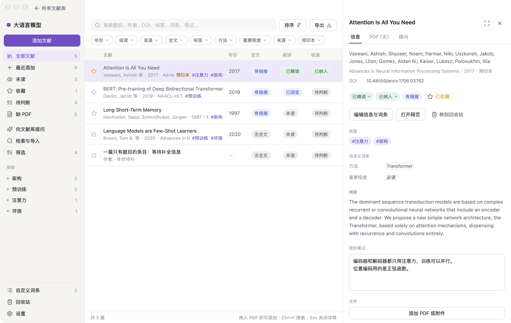

<p align="center">
  
</p>

<h1 align="center">Wisp Paper</h1>

<p align="center">
  <b>本地优先的文献库：收集、筛选、阅读，向你的文献提问。</b><br>
  用 Rust + GPUI 原生绘制。文献和 PDF 留在你的电脑上，每个文献库就是一个文件夹。
</p>

<p align="center">
  
  
  <a href="LICENSE"></a>
  
</p>

<p align="center">
  <a href="#安装"><b>安装</b></a> ·
  <a href="#功能">功能</a> ·
  <a href="docs/CLI.md">命令行与 MCP</a> ·
  <a href="docs/DATA.md">数据与隐私</a> ·
  <a href="docs/DEVELOPMENT.md">开发</a>
</p>

<p align="center">
  
</p>

> [!NOTE]
> Wisp Paper 还在早期，变化很快，目前没有安装包，需要从源码构建。界面只有中文。遇到问题或有想法，欢迎[提 issue](https://github.com/xuzhougeng/WispPaper/issues)，更欢迎直接发 pull request。

## 为什么是 Wisp Paper

**🔒 本地优先，文献是你自己的。** 不需要账号，没有云端。每个文献库是数据目录下的一个独立文件夹，数据库、PDF、自定义词条都在里面，可以单独备份或整个拷走。删除只是移动到 `removed/`，什么都不会真的丢。哪些数据会离开本机，逐条写在[数据与隐私](docs/DATA.md)里。

**🐋 先广泛导入，再让助手帮你筛。** 为 PubMed、Europe PMC、Crossref、arXiv 保存检索式，成批导入；助手逐篇阅读，给出建议、理由和一句逐字引自原文的依据。建议只是建议：每一篇收不收，由你确认。

**💬 回答带出处，出处能点开。** 向整个文献库或单篇文献提问，材料不够时助手自己去检索全文、按页翻阅。回答里的 `[P3 p.5]` 可以点击，打开 PDF 跳到那一页，所引的原句在页面上高亮。

**⚡ 原生界面，不是网页。** 整个界面由 Rust 和 [GPUI](https://www.gpui.rs/) 在 GPU 上绘制，没有 WebView，没有 Electron。PDF 用纯 Rust 的 [hayro](https://github.com/LaurenzV/hayro) 渲染，不依赖系统 PDF 库。

## 安装

目前没有发布安装包。需要 Rust（版本见 `rust-toolchain.toml`，rustup 会自动安装）；Windows 上还需要 MSVC 构建工具。

```sh
git clone https://github.com/xuzhougeng/WispPaper
cd WispPaper
cargo run --release
```

| 平台 | 状态 |
|---|---|
| **Windows** | 支持 |
| **macOS** | 支持 |
| **Linux** | 可以编译，未测试 |

想先看看效果，可以生成一个带示例数据的目录，不碰你真正的文献库：

```sh
cargo run -p wisp_core --example seed -- /tmp/wisp-demo some.pdf
WISP_PAPER_HOME=/tmp/wisp-demo cargo run
```

提问、建库向导和筛选需要一个模型服务，在「设置 › AI」里配置：Claude API、OpenAI 兼容的 chat/completions，或 OpenAI 的 Responses 接口。

## 功能

- **文献库**：多个独立的文献库，各有名称、主题描述和标识色。
- **收集**：粘贴 DOI 或 PMID，拖入 PDF，导入 BibTeX / RIS，或手动录入。按 DOI、PMID、题目去重。
- **整理**：搜索、筛选、排序；阅读状态、收录判断、收藏、标签、笔记；每个库自己定义的词条；回收站；导出 BibTeX 和 CSV。
- **检索与导入**：保存检索式，先试检索再导入，每次导入可以整批撤销；可以定时自动更新。
- **建库向导**：写下主题，助手为各个数据库拟几条检索式并逐条试检索，你挑靠谱的。
- **筛选**：助手逐篇给出收录建议和原文依据，你来确认。
- **提问**：对文献库或单篇文献提问，出处可点击并在 PDF 里高亮；`/search` 检索全文，`/cite` 为一段文字找可引用的文献。
- **PDF 预览**：在详情面板里直接看，可展开成阅读宽度。
- **命令行与 MCP**：`wisp` 不开窗口就能读写同一个数据目录，`wisp mcp` 把同一组工具交给外部的 AI 客户端。见 [docs/CLI.md](docs/CLI.md)。
- **设置**：浅色 / 深色，可改键的快捷键，全局代理和每个模型服务单独的代理。改动即时保存。

每一项的细节在 [docs/FEATURES.md](docs/FEATURES.md)。

## 文档

| | |
|---|---|
| [功能详解](docs/FEATURES.md) | 每个页面能做什么 |
| [数据与隐私](docs/DATA.md) | 文件放在哪里，哪些数据会离开本机 |
| [命令行与 MCP](docs/CLI.md) | `wisp` 的用法、工具一览、MCP 配置 |
| [开发](docs/DEVELOPMENT.md) | 构建、测试、代码结构 |

## 致谢

文献部分移植自 [BiblioCell](https://github.com/xuzhougeng/BiblioCell)（它的数据集和网页版没有移植），应用结构参考 [quiet-md](https://github.com/s1dashu/quiet-md)。

## 许可

代码以 [MIT](LICENSE) 许可发布。随附的第三方代码和素材见 [THIRD_PARTY.md](THIRD_PARTY.md)。
